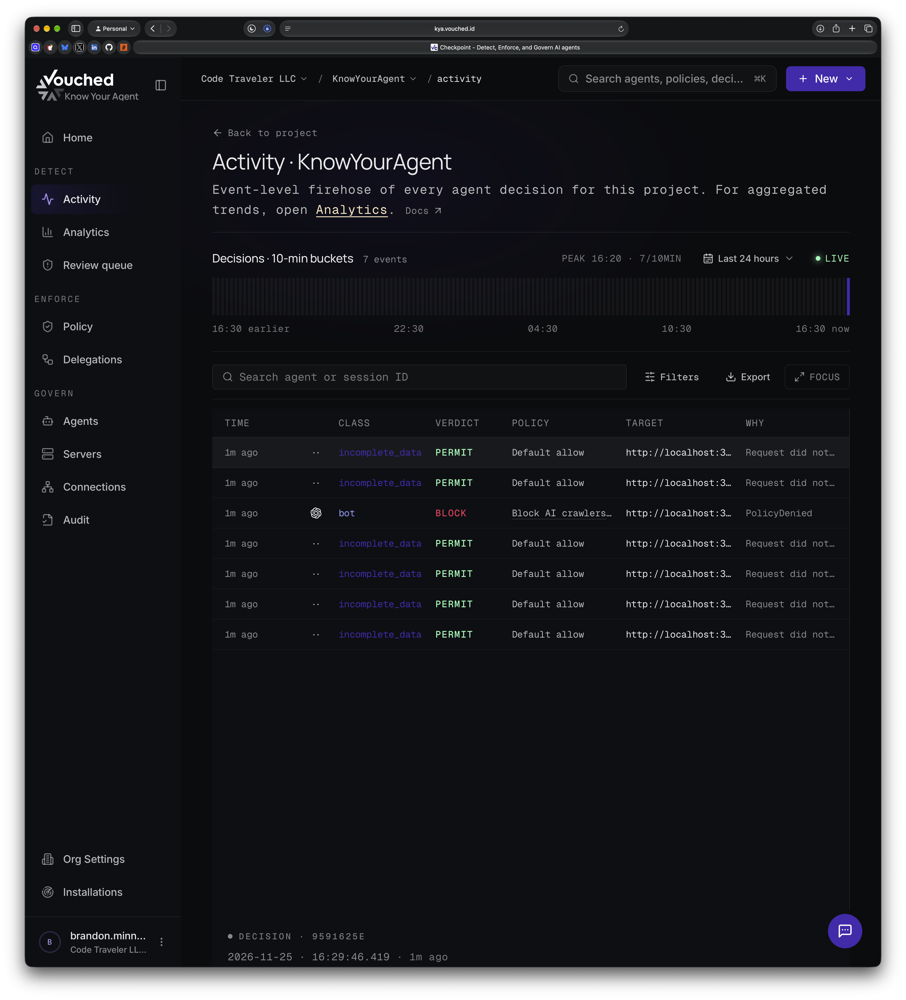

# Blocking AI Crawlers in Next.js with Vouched KYA

Not every AI visitor is the same. AI crawlers collect training data for AI models, while AI agents browse our websites on behalf of real people. But the good news is that we can block one and welcome the other! With Vouched KYA (short for Know Your Agent), it only takes one policy, and it's just five lines long.

Want to see every step? Here's the video walkthrough:

[VIDEO: embed Video 2, "Block GPTBot, not ChatGPT"]

## Blocking Crawlers Without Blocking Customers

Say our startup sells proprietary data through an API, and our website shows free previews of it. We want search engines and new customers to find us. However, AI crawlers, like OpenAI's GPTBot and Anthropic's ClaudeBot, copy every one of our pages and then their AI models dish out the data that our customers pay for. And every page they read runs our server, increasing our cloud bill.

AI agents are different. When ChatGPT visits our website, it's browsing for a real person, like a developer comparing using our APIs, and we definitely want to let them in.

We could ask the crawlers to stay out in `robots.txt`, but that's only a request, and not every crawler honors it. So let's actually block them.

## One Policy, Five Lines Long

[KYA Detect](https://kya.vouched.id/docs/detect?utm_source=vouched-blog&utm_medium=blog&utm_campaign=kya-brandon-enforce-2026-11&utm_content=post) labels every request as a Human, an AI Agent or a Bot. Then [KYA Enforce](https://kya.vouched.id/docs/enforce?utm_source=vouched-blog&utm_medium=blog&utm_campaign=kya-brandon-enforce-2026-11&utm_content=post) applies our Policy, a rule that decides what happens for each incoming request. Here's ours, written in [Cedar](https://www.cedarpolicy.com/), an open-source language for access rules:

```text
// Block AI crawlers on every page
@id("block-ai-crawlers")
@verdict("BLOCK")
forbid (principal, action, resource)
when { principal.category == "scraper" };
```

Vouched KYA then reads it back to us in plain English: "Block scraper agents on every path, no way through". And anything our policy doesn't block is still allowed, so AI agents and search engines still get in.

> **Note:** `scraper` is Vouched KYA's name for AI crawlers

And the best part is that we can test our policy before it blocks anyone. Once we're happy with it, we change one word in [`proxy.ts`](https://nextjs.org/docs/app/getting-started/proxy): `observe` -> `enforce` and our policy is live!

## The Outcome: GPTBot Gets a 403, ChatGPT Gets In

- GPTBot, an AI crawler, is blocked with a `403 Forbidden`.
- ChatGPT, an AI agent, gets in with a `200 OK`.
- Googlebot, Google's search crawler, gets in too, so our search traffic is safe.

And when a crawler asks for a web page, it gets our own blocked page instead.

In our [Vouched KYA dashboard](https://kya.vouched.id/dashboard?utm_source=vouched-blog&utm_medium=blog&utm_campaign=kya-brandon-enforce-2026-11&utm_content=post), under **Activity**, every blocked request shows the verdict **BLOCK**, with our policy's name and the reason.



## Try It Yourself

The video above picks up where the [first post in this series](https://www.vouched.id/learn/blog/detecting-ai-agents-in-next.js-with-vouched-kya?utm_source=vouched-blog&utm_medium=blog&utm_campaign=kya-brandon-enforce-2026-11&utm_content=post) left off, after we added KYA Detect to a Next.js app. To follow along, we'll need a [Vouched KYA account](https://kya.vouched.id/signup?utm_source=vouched-blog&utm_medium=blog&utm_campaign=kya-brandon-enforce-2026-11&utm_content=post) on a paid plan.

> **Note:** KYA Enforce isn't available in the free plan

To learn more about writing policies, check out the [KYA Enforce policy docs](https://kya.vouched.id/docs/enforce/policies?utm_source=vouched-blog&utm_medium=blog&utm_campaign=kya-brandon-enforce-2026-11&utm_content=post).

In the next post, we'll verify signed AI agents!

Subscribe to the Vouched KYA newsletter at the bottom of the [Vouched KYA home page](https://kya.vouched.id/?utm_source=vouched-blog&utm_medium=blog&utm_campaign=kya-brandon-enforce-2026-11&utm_content=post) so you don't miss it!