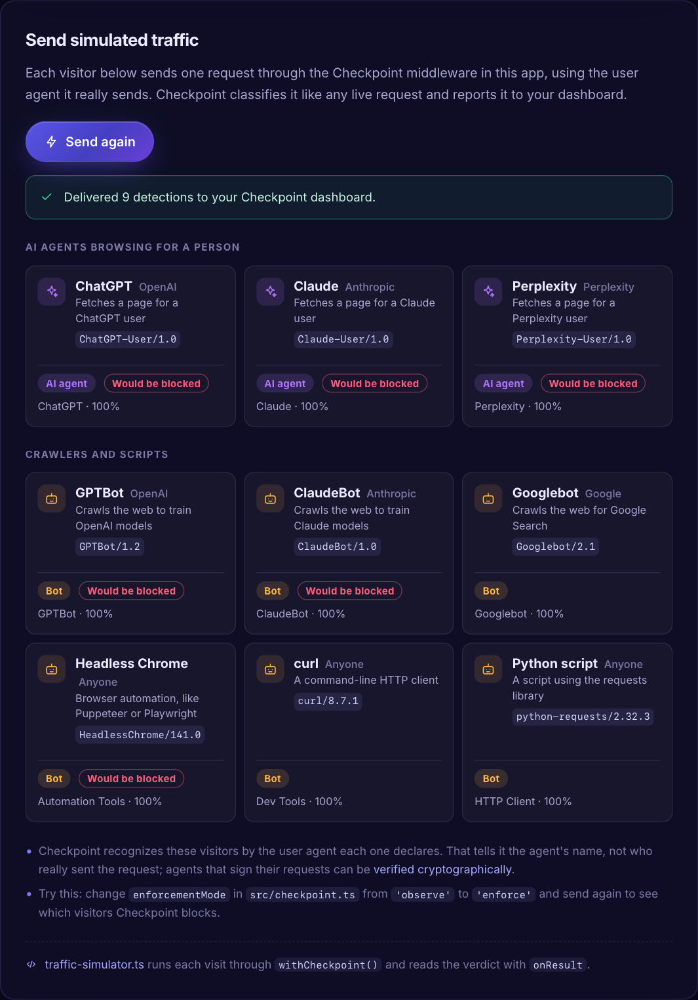

# Detecting AI Agents in Next.js with Vouched KYA

AI agents like ChatGPT, Claude and Perplexity are already browsing websites on behalf of real people, and most of our websites can't tell them apart from humans or crawlers. But the good news is that we can fix that! In this post, we'll add Vouched KYA's Detect to a Next.js app in about 5 minutes, for free.

## What are Know Your Agent and Detect?

You've probably heard of KYC (Know Your Customer). [Know Your Agent](https://kya.vouched.id/?utm_source=vouched-blog&utm_medium=blog&utm_campaign=kya-brandon-nextjs-2026-11&utm_content=intro-kya) (KYA) is the same idea for the agent era: knowing which AI agents are interacting with our business, and which human authorized them. [Vouched](https://www.vouched.id/?utm_source=vouched-blog&utm_medium=blog&utm_campaign=kya-brandon-nextjs-2026-11&utm_content=intro-vouched) built Vouched KYA on KYA-OS, an open standard it has donated to the [Decentralized Identity Foundation](https://identity.foundation).

[Vouched Detect](https://kya.vouched.id/docs/detect?utm_source=vouched-blog&utm_medium=blog&utm_campaign=kya-brandon-nextjs-2026-11&utm_content=intro-detect) classifies every request that reaches our servers as `human`, `ai_agent`, `bot` or `incomplete_data`. In Next.js, we run Vouched's detection engine right inside our app's [Proxy](https://nextjs.org/docs/app/getting-started/proxy), adding just a few milliseconds to each request. And - the best part - Detect has a [free tier](https://kya.vouched.id/pricing?utm_source=vouched-blog&utm_medium=blog&utm_campaign=kya-brandon-nextjs-2026-11&utm_content=intro-pricing), no card required, that lets us try additional services like [Enforce](https://kya.vouched.id/docs/enforce?utm_source=vouched-blog&utm_medium=blog&utm_campaign=kya-brandon-nextjs-2026-11&utm_content=intro-enforce) and [Govern](https://kya.vouched.id/docs/govern?utm_source=vouched-blog&utm_medium=blog&utm_campaign=kya-brandon-nextjs-2026-11&utm_content=intro-govern), where we can apply policies to agents and verify who authorized them. (We'll cover those in future posts!)

## Code

You can find the completed code sample here: [https://github.com/vouched/KnowYourAgentWebsite-Nextjs-Sample](https://github.com/vouched/KnowYourAgentWebsite-Nextjs-Sample)

### Prerequisites

- A Next.js 16 app, using the App Router or the Pages Router
- [Node.js 22.12](https://nodejs.org/en/download) or later
- A free [Vouched KYA account](https://kya.vouched.id/signup?utm_source=vouched-blog&utm_medium=blog&utm_campaign=kya-brandon-nextjs-2026-11&utm_content=prereq-signup) with a project and an API key (it starts with `sk_`). 

### 1. Add the npm Package

```bash
npm install @kya-os/checkpoint-nextjs
```

### 2. Store our API Key (Safely!)

Our API key is a secret, so it should NEVER be committed to source control. Next.js loads environment variables from `.env.local`, and the `.gitignore` that `create-next-app` generates already ignores it. Be sure to double-check your `.gitignore`; your future-self will thank you 💯.

In the root of our project, create `.env.local`:

```bash
CHECKPOINT_API_KEY=<your api key>
```

And when we deploy to production, be sure to set the same environment variable in our host, like Vercel.

### 3. Add Vouched KYA to proxy.ts

Next.js runs `proxy.ts` before every request, which makes it the perfect place for Detect. Create `proxy.ts` in the root of our project, or in `src/` if our app uses one:

```ts
import { withCheckpoint } from "@kya-os/checkpoint-nextjs";

export default withCheckpoint({
  // Reports every request to our Vouched KYA dashboard
  apiKey: process.env.CHECKPOINT_API_KEY,

  // Observe mode: classify and report every request, but don't block them
  enforcementMode: "observe",
});

export const config = {
  // Run on every page, skipping Next.js' static files
  matcher: ["/((?!_next/static|_next/image|favicon.ico).*)"],
};
```

And that's it! Just one function call and we're up and running.

`withCheckpoint` enforces policies by default, so in this example, we turn on observe mode explicitly. And if we forget our API key, our app still works; the SDK just can't report to our dashboard.

### 4. Run the App

```bash
npm run dev
```

Our website looks exactly the same, and that's the point.

### 5. Simulate Agent + Bot Traffic

Now let's pretend to be ChatGPT. 

In a second terminal (on Windows PowerShell, type `curl.exe` instead of `curl`):

```bash
curl -I -A "Mozilla/5.0 AppleWebKit/537.36 (KHTML, like Gecko); compatible; ChatGPT-User/1.0; +https://openai.com/bot" http://localhost:3000/
```

Among the response headers, we'll find these:

```text
HTTP/1.1 200 OK
x-checkpoint-mode: observe
x-checkpoint-would-have-been: Permit
```

It works! Detect is running in observe mode, and `Permit` is what it would have done if it were enforcing. Within a minute, our request shows up in the [Vouched KYA dashboard](https://kya.vouched.id/dashboard?utm_source=vouched-blog&utm_medium=blog&utm_campaign=kya-brandon-nextjs-2026-11&utm_content=step5-dashboard) under **Detect → Activity** as an `ai_agent` named ChatGPT. 🎉 Not seeing it? Add `debug: true` to `withCheckpoint`, and the SDK logs why a report didn't reach Vouched, like a mistyped API key.

Next, try OpenAI's GPTBot user agent:
```bash
curl -I -A "Mozilla/5.0 AppleWebKit/537.36 (KHTML, like Gecko); compatible; GPTBot/1.4; +https://openai.com/gptbot" http://localhost:3000/
```

The dashboard labels it a `bot`, because it's a crawler collecting training data, not an AI assistant browsing on behalf of a person.

### 6. Logging in Code

The SDK calls `onResult` after it classifies each request, the perfect place to log it, send it to our analytics, or save it to our database. Let's add it to `proxy.ts`:

```ts
export default withCheckpoint({
  apiKey: process.env.CHECKPOINT_API_KEY,
  enforcementMode: "observe",

  // Runs after Vouched KYA classifies each request
  onResult: (result, request) => {
    const { detectionClass, detectedAgent, confidence } = result.detectionDetail;
    console.log(
      `${request.nextUrl.pathname}: ${detectionClass.type} ${detectedAgent?.name ?? ""} (${Math.round(confidence)}%)`,
    );
  },
});
```

Send the ChatGPT and GPTBot requests again, plus plain old `curl -I http://localhost:3000/`, and our terminal shows:

```text
/: AiAgent ChatGPT (100%)
/: Bot GPTBot (100%)
/: Bot Dev Tools (100%)
```

Vouched KYA even knows curl is a developer tool! One thing to know: the SDK waits for `onResult` before it responds, so for slow work, use [`after()`](https://nextjs.org/docs/app/api-reference/functions/after) to run it after the response is sent.

## Bonus: Unit Testing our Proxy

Because the engine runs inside our app, we can unit test `proxy.ts` with any user agent we like, no network required. The sample's [Vitest tests](https://github.com/vouched/KnowYourAgentWebsite-Nextjs-Sample/tree/main/test) do exactly that, with [helpers](https://github.com/vouched/KnowYourAgentWebsite-Nextjs-Sample/tree/main/test/support) that fake Vouched's API, so our CI catches any `@kya-os/checkpoint-nextjs` update that changes how our traffic is classified.

## Conclusion

AI agents are already visiting our websites, and with `@kya-os/checkpoint-nextjs`, it only takes one function call (and zero dollars) to start seeing them.

The [completed sample](https://github.com/vouched/KnowYourAgentWebsite-Nextjs-Sample) does everything in this post, plus one fun extra: paste your Project ID and API key into the page, click **Send simulated traffic**, and watch ChatGPT, Claude, Perplexity, GPTBot and more arrive in your dashboard!



_Why "Would be blocked"?_ The sample adds `engineConfig: { tier3Action: "block" }`, which tells Vouched KYA to block known AI agents, AI crawlers and headless browsers. Our `proxy.ts` leaves it out, which is why ChatGPT got `Permit`. In observe mode, nothing gets blocked either way.

Building with .NET instead? Check out the [Blazor Server sample](https://github.com/vouched/KnowYourAgentWebsite-Dotnet-Blazor).

Next, we'll move from observing to enforcing with Enforce. Subscribe to the Vouched KYA newsletter at the bottom of the [Vouched KYA home page](https://kya.vouched.id/?utm_source=vouched-blog&utm_medium=blog&utm_campaign=kya-brandon-nextjs-2026-11&utm_content=conclusion-newsletter) so you don't miss it!
