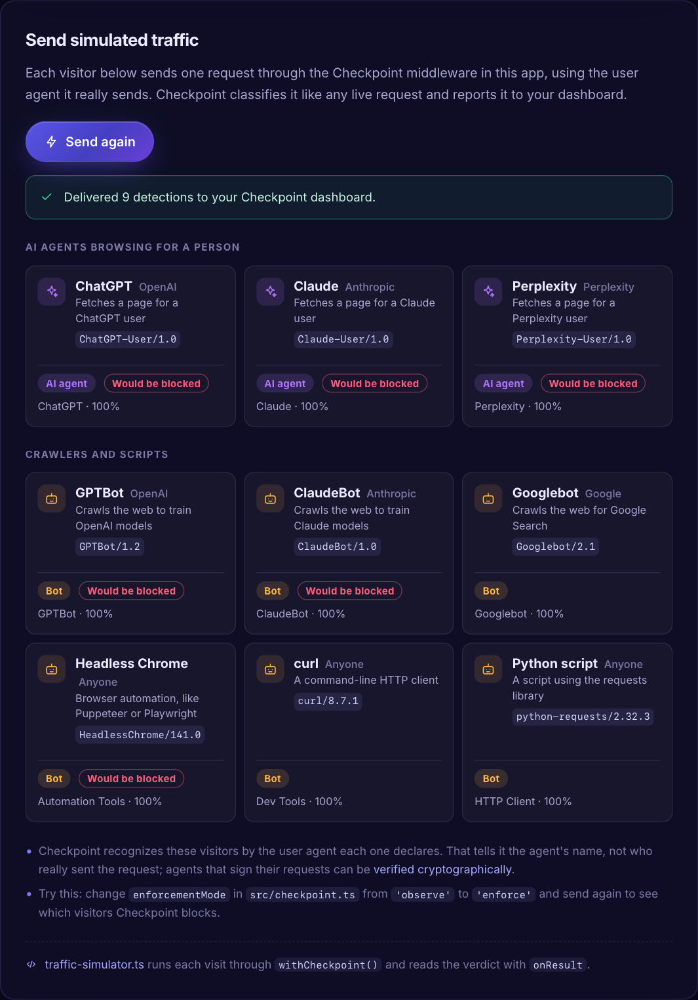
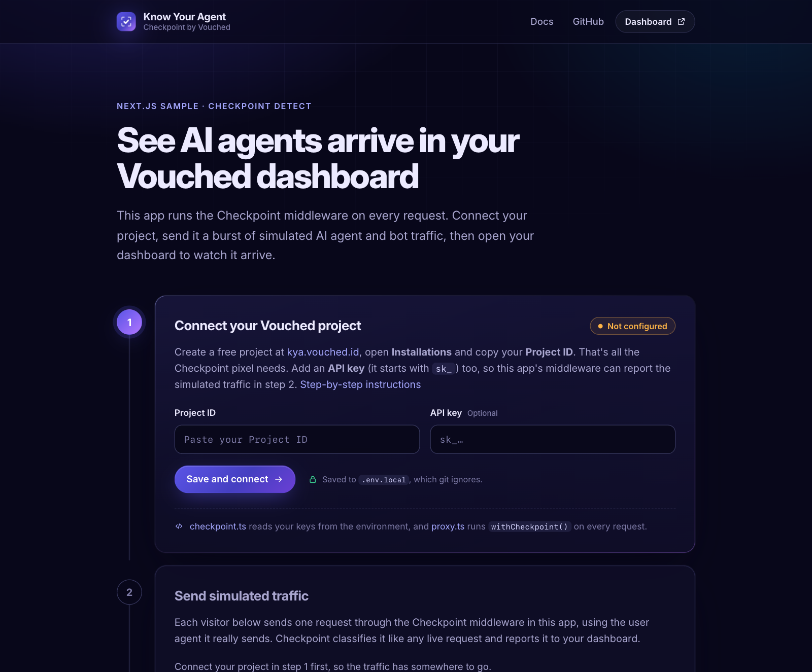

# Know Your Agent: a Vouched KYA sample for Next.js

[](https://github.com/vouched/KnowYourAgentWebsite-Nextjs-Sample/actions/workflows/build.yml)
[](LICENSE)
[](https://nodejs.org/en/download)
[](https://www.npmjs.com/package/@kya-os/checkpoint-nextjs)

A small Next.js app that shows how to add [Vouched KYA](https://kya.vouched.id/docs/integrations/nextjs) to a website. Run it, connect your Vouched project, send it simulated AI agent and bot traffic, and watch every visit arrive in your Vouched KYA dashboard.

Prefer .NET? The same sample for ASP.NET Core lives in [KnowYourAgentWebsite-Dotnet-Blazor](https://github.com/TheCodeTraveler/KnowYourAgentWebsite-Dotnet-Blazor).



## Get your Project ID and API key

You need a free Vouched account and a Vouched KYA project. Detect is free, so there's no credit card to enter.

### 1. Create a project

1. Sign up at [kya.vouched.id/signup](https://kya.vouched.id/signup), or [sign in](https://kya.vouched.id/signin) if you already have an account. The first time you sign in, you're asked to create an organization.
2. Click **New** in the top navigation, then **New project**.
3. Enter a **Project Name**, like `Know Your Agent sample`, and the **Site URL** of the website you'll protect, like `https://example.com`. This sample still runs on `localhost`.
4. Click **Add Domain**. The project is created right away, and the dialog shows its installation steps.

### 2. Copy your Project ID

Open **Installations** in the project's left rail and start the Detect setup with **Configure & install**. Every install snippet includes your Project ID. In the pixel snippet, it's the `data-project-id` value. The ID is all you need from the snippet, because this sample already contains the rest.

### 3. Create an API key (optional)

[Install the `kya-os` CLI](https://kya.vouched.id/docs/installation). Once you have Node.js (see [Run it](#run-it)), that's one command: `npm install --global @kya-os/cli`. On Windows, the CLI runs in [WSL](https://learn.microsoft.com/windows/wsl/install); you can also paste your keys into the app instead.

From the folder you cloned this sample into, use the following commands to create your API key and save it, along with your Project ID, to this app's `.env.local` file. The CLI may print lines to add to `proxy.ts`; skip them, since [`src/proxy.ts`](src/proxy.ts) already has them.

```bash
kya-os login
kya-os detect install --surface sdk --project <your project id>
```

Once these commands are run, you'll find `CHECKPOINT_PROJECT_ID` and `CHECKPOINT_API_KEY` in `.env.local`, which git ignores.

The API key is optional:

| You add                | What shows up in your dashboard                                                                  |
| ---------------------- | ------------------------------------------------------------------------------------------------ |
| Project ID             | Your visits to this sample, reported by the Vouched KYA pixel in your browser                    |
| Project ID and API key | Your visits, plus everything the Vouched KYA middleware detects, including the simulated traffic |

## Run it

New to JavaScript? No problem. These steps start from a computer with nothing installed. If you already use Node.js 22.12 or later, skip to [step 2](#2-download-the-code).

### 1. Install the prerequisites

You need two free tools, and a terminal to type commands into: **Terminal** on macOS, **Windows Terminal** or **PowerShell** on Windows, or the terminal built into [Visual Studio Code](https://code.visualstudio.com).

**Node.js** runs JavaScript on your computer, the way the .NET runtime runs C#. It comes with **npm**, which downloads the packages an app depends on, the way NuGet does for .NET. Install the **LTS** (Long Term Support) version, which is Node.js 24:

| Your computer | How to install Node.js                                                                                                                                                              |
| ------------- | ----------------------------------------------------------------------------------------------------------------------------------------------------------------------------------- |
| Windows       | Download and run the **Windows Installer (.msi)** from [nodejs.org/en/download](https://nodejs.org/en/download), or run `winget install OpenJS.NodeJS.LTS`                          |
| macOS         | Download and run the **macOS Installer (.pkg)** from [nodejs.org/en/download](https://nodejs.org/en/download), or run `brew install node@24` if you use [Homebrew](https://brew.sh) |
| Linux         | Follow [nodejs.org/en/download](https://nodejs.org/en/download), which covers the package managers of each distribution                                                             |

**Git** downloads the code. Many computers already have it:

| Your computer | How to install Git                                                                                                                  |
| ------------- | ----------------------------------------------------------------------------------------------------------------------------------- |
| Windows       | Download and run the installer from [git-scm.com/downloads](https://git-scm.com/downloads), or run `winget install --id Git.Git -e` |
| macOS         | Run `xcode-select --install`, which installs Apple's developer tools, Git included                                                  |
| Linux         | Use your package manager, for example `sudo apt install git`                                                                        |

When the installers finish, **close your terminal and open a new one**, so it picks up the new commands. Then check that everything is ready:

```bash
node --version
npm --version
git --version
```

You should see `v24` or later (`v22.12` or later works too) for Node.js, and any version number for npm and Git.

> [!TIP]
> Rather not install Git? On this repository's GitHub page, click **Code**, then **Download ZIP**, unzip it and open a terminal in the unzipped folder. Then skip the `git clone` and `cd` commands below.

### 2. Download the code

```bash
git clone https://github.com/vouched/KnowYourAgentWebsite-Nextjs-Sample.git
cd KnowYourAgentWebsite-JavaScript-Nextjs
```

### 3. Install the app's packages

```bash
npm install
```

npm downloads everything listed in [`package.json`](package.json) into a `node_modules` folder. It takes a minute the first time, and you only need to run it again when `package.json` changes. It may print a few warnings, including a vulnerability summary. The moderate findings come from development tools. The high ones all come from one advisory in [Zod](https://github.com/advisories/GHSA-mrhx-c7xc-m3w5), a library the Vouched KYA and Vercel packages depend on, and they go away when those packages update.

### 4. Start the app

```bash
npm run dev
```

When you see `Ready`, open **http://localhost:3000** in your browser:

```text
▲ Next.js 16.4.2 (Turbopack)
- Local:         http://localhost:3000
✓ Ready in 312ms
```

The app reloads by itself whenever you save a change to its code. To stop it, click into the terminal and press **Ctrl+C**.

### 5. Follow the three steps on the page

1. **Connect your Vouched project.** Paste your Project ID, and your API key if you have it. The app saves them to `.env.local`, and Next.js picks them up a moment later, with no restart needed.
2. **Send simulated traffic.** This step requires an API key. One button sends a request from ChatGPT, Claude, Perplexity, GPTBot, ClaudeBot, Googlebot, Headless Chrome, curl and a Python script through the Vouched KYA middleware, shows how Vouched KYA classified each one, and reports every visit to your dashboard.
3. **Watch it arrive in your dashboard.** Open [your dashboard](https://kya.vouched.id/dashboard), switch to the project you connected, and go to **Detect → Activity**. With an API key, each simulated visit appears with its class, confidence and agent name, usually within a minute. With only a Project ID, look for your own visit, reported by the pixel.



> [!NOTE]
> Saving keys and sending traffic only work in `npm run dev`, and only when you browse the app on the same machine. A production build never exposes them, and they turn away requests from other machines, dev tunnels and reverse proxies. Like any development server, don't expose it to the internet.

Prefer to skip the form? Copy [`.env.example`](.env.example) to `.env.local` and fill in your keys. Next.js loads `.env.local` automatically.

### Command cheat sheet for .NET developers

| What you want to do                | In this app            | The .NET equivalent                          |
| ---------------------------------- | ---------------------- | -------------------------------------------- |
| Install the packages               | `npm install`          | `dotnet restore`                             |
| Run the app, reloading as you edit | `npm run dev`          | `dotnet watch`                               |
| Run the tests                      | `npm test`             | `dotnet test`                                |
| Build for production               | `npm run build`        | `dotnet publish -c Release`                  |
| Run the production build           | `npm start`            | `dotnet <your app>.dll`                      |
| Check formatting                   | `npm run format:check` | `dotnet format --verify-no-changes`          |
| Find likely bugs                   | `npm run lint`         | The analyzers that run during `dotnet build` |

And the files you'd look for in a .NET project:

| In this app         | The .NET equivalent                              |
| ------------------- | ------------------------------------------------ |
| `package.json`      | The `<PackageReference>` items in your `.csproj` |
| `package-lock.json` | `packages.lock.json`                             |
| `node_modules/`     | Your NuGet packages folder                       |
| `.env.local`        | .NET user secrets                                |
| `src/proxy.ts`      | `app.UseCheckpoint()` in `Program.cs`            |

### If something goes wrong

- **`node`, `npm` or `git` is "not recognized" or "command not found".** Close your terminal (or Visual Studio Code) and open it again, so it picks up the newly installed tools. If that doesn't help, restart your computer.
- **Windows PowerShell says `npm.ps1 cannot be loaded because running scripts is disabled`.** Run `Set-ExecutionPolicy -Scope CurrentUser RemoteSigned` once, or use Command Prompt instead.
- **Next.js says your Node.js version is too old.** Install Node.js 24 as described above, then open a new terminal.
- **Port 3000 is in use.** Next.js tries the next free port and prints it; open that address instead.
- **Nothing shows up in your dashboard.** See [Not seeing traffic in your dashboard?](#not-seeing-traffic-in-your-dashboard)
- **Every page says `Service temporarily unavailable` (HTTP 503).** Vouched KYA couldn't load your dashboard's policies, usually because Vouched rejected your API key. On your own machine with `npm run dev`, the page still loads and the terminal says so: paste a new key in step 1. A deployed app keeps answering 503 until it has a working key.

## Not seeing traffic in your dashboard?

- **Check the project.** The dashboard shows one project at a time, and the app sends everything to the Project ID in step 1. You'll find each project's ID under **Installations**.
- **Check Activity's filters.** Widen the time range and clear any filters.
- **Add an API key for the simulated traffic.** With only a Project ID, the dashboard shows the visits the pixel reports from your browser, not the simulated traffic.
- **Check the pixel.** Browser extensions that block trackers can block `kya.vouched.id/pixel.js`. Add `CHECKPOINT_PIXEL_DEBUG=true` to `.env.local` and the pixel logs every report it sends to your browser's console.

## How it works

Vouched KYA's Next.js middleware comes from the [`@kya-os/checkpoint-nextjs`](https://www.npmjs.com/package/@kya-os/checkpoint-nextjs) npm package. It runs Vouched's detection engine inside your app, classifies every request as a person, an AI agent or a bot before your pages run, and reports what it sees to your dashboard. The package and its APIs use the name Checkpoint, so you'll see it throughout the code.

| File                                                                                 | What to look at                                                                                                                                                                                        |
| ------------------------------------------------------------------------------------ | ------------------------------------------------------------------------------------------------------------------------------------------------------------------------------------------------------ |
| [`src/proxy.ts`](src/proxy.ts)                                                       | `withCheckpoint(checkpointConfig())` runs Vouched KYA on every request the `matcher` covers. Next.js 16 calls this file `proxy.ts`; older versions call it `middleware.ts`                             |
| [`src/checkpoint.ts`](src/checkpoint.ts)                                             | Vouched KYA's settings, starting in observe mode, plus your keys from the environment. Without an API key, the middleware classifies requests locally instead of failing to reach your dashboard       |
| [`next.config.ts`](next.config.ts)                                                   | Loads the engine from `node_modules` with `serverExternalPackages`, which the traffic simulator's Server Function needs, and sends security headers, including a Content-Security-Policy in production |
| [`src/components/checkpoint-pixel.tsx`](src/components/checkpoint-pixel.tsx)         | Adds the Vouched KYA pixel, which only needs your Project ID                                                                                                                                           |
| [`src/lib/simulation/traffic-simulator.ts`](src/lib/simulation/traffic-simulator.ts) | Runs each simulated visit through `withCheckpoint`, reads the verdict with `onResult`, and reports it with the same payload the middleware sends, so it can tell you whether Vouched accepted it       |
| [`src/lib/simulation/visitors.ts`](src/lib/simulation/visitors.ts)                   | The real user agents of the simulated visitors. Add your own!                                                                                                                                          |
| [`src/app/blocked/page.tsx`](src/app/blocked/page.tsx)                               | The page Vouched KYA shows the agents it blocks in enforce mode                                                                                                                                        |
| [`src/instrumentation.ts`](src/instrumentation.ts)                                   | In production, the app won't serve pages without a Project ID, and its log says exactly how to add one                                                                                                 |

Vouched KYA recognizes the simulated visitors by the user agent each one declares. That tells it the agent's name, not who really sent the request. Agents that sign their requests can be [verified cryptographically](https://kya.vouched.id/docs/detect/verification).

## Keeping your keys out of git

- Keys are only read from environment variables: `.env.local` on your machine, and your host's environment variables when you deploy.
- `.gitignore` excludes every `.env` file except `.env.example`, which only holds placeholders, and the `.kya-os/` folder the kya-os CLI creates.
- On macOS and Linux, the app writes `.env.local` so only your user can read it.
- The API key is never displayed; the page only shows its last four characters.
- The Vouched KYA pixel only loads once _your_ Project ID is configured, so a fork never reports to someone else's project.

## Configuration

| Setting                    | Where                                    | Default                                    | What it does                                                                                                |
| -------------------------- | ---------------------------------------- | ------------------------------------------ | ----------------------------------------------------------------------------------------------------------- |
| `CHECKPOINT_PROJECT_ID`    | Environment                              | _(none)_                                   | Your Vouched KYA project. The pixel only needs this.                                                        |
| `CHECKPOINT_API_KEY`       | Environment                              | _(none)_                                   | Optional. Lets the middleware report its detections and apply your dashboard policies. **Never commit it.** |
| `CHECKPOINT_PIXEL_DEBUG`   | Environment                              | `false`                                    | Logs every report the pixel sends to your browser's console                                                 |
| `CHECKPOINT_BASE_URL`      | Environment                              | `https://kya.vouched.id`                   | Only for a staging or self-hosted Vouched KYA dashboard                                                     |
| `enforcementMode`          | [`src/checkpoint.ts`](src/checkpoint.ts) | `'observe'`                                | `'observe'` classifies and reports every request but never blocks; `'enforce'` blocks what the engine flags |
| `engineConfig.tier3Action` | [`src/checkpoint.ts`](src/checkpoint.ts) | `'block'`                                  | Flags known AI agents, AI crawlers and headless browsers                                                    |
| `matcher`                  | [`src/proxy.ts`](src/proxy.ts)           | Everything but static files and `/healthz` | Which requests Vouched KYA checks                                                                           |
| `site.repositoryUrl`       | [`src/lib/site.ts`](src/lib/site.ts)     | This repository                            | Source links for your fork                                                                                  |

See the [middleware reference](https://kya.vouched.id/docs/enforce/middleware) for every option `withCheckpoint` supports.

> [!TIP]
> Change `enforcementMode` to `'enforce'` in [`src/checkpoint.ts`](src/checkpoint.ts) and send the simulated traffic again. Vouched KYA blocks the AI agents, AI crawlers and Headless Chrome, but lets Googlebot, curl and the Python script through.

## Run the tests

```bash
npm test
```

No Vouched keys or network access are needed. [`test/support/setup.ts`](test/support/setup.ts) swaps the Vouched API for a fake that records every detection Vouched KYA reports, while every request still runs through the real detection engine.

| Test file                                                               | What it shows                                                                                                                     |
| ----------------------------------------------------------------------- | --------------------------------------------------------------------------------------------------------------------------------- |
| [`checkpoint-detection.test.ts`](test/checkpoint-detection.test.ts)     | How `src/proxy.ts` classifies AI agents, crawlers, scripts and a real Chrome browser, read from what it reports to your dashboard |
| [`checkpoint-enforcement.test.ts`](test/checkpoint-enforcement.test.ts) | What observe and enforce mode do, and that enforcing never blocks people                                                          |
| [`traffic-simulator.test.ts`](test/traffic-simulator.test.ts)           | That every simulated visit is classified and delivered to your dashboard, and what happens when Vouched turns it away             |
| [`actions.test.ts`](test/actions.test.ts)                               | That saving keys writes `.env.local`, and that the developer tools stay off for other machines                                    |

These tests pin the behavior of the `@kya-os/checkpoint-nextjs` package. When Dependabot proposes an update that changes how traffic is classified, CI tells you before your users notice.

## Deploying

Build with `npm run build`, then run `npm start` on any Node.js 22.12+ host, or deploy to a platform like [Vercel](https://vercel.com). Either way:

- Set `CHECKPOINT_PROJECT_ID` (and optionally `CHECKPOINT_API_KEY`) in your host's environment variables. Without a Project ID, every page returns an error and the server log explains how to fix it.
- Point your host's health probe at `/healthz`.
- Tell Vouched KYA which proxy to trust for the visitor's IP address with `clientIpPolicy` in [`src/checkpoint.ts`](src/checkpoint.ts): `{ platform: 'vercel' }` on Vercel, or `{ platform: 'trusted-proxy', trustedHops: 1 }` behind a reverse proxy of your own.

## Contributing

Issues and pull requests are welcome. Before you open a PR, run:

```bash
npm run format:check
npm run lint
npm run typecheck
npm test
npm run build
```

AI coding agents should read [`AGENTS.md`](AGENTS.md). Please report security issues privately as described in [SECURITY.md](SECURITY.md).

## License

[MIT](LICENSE)
