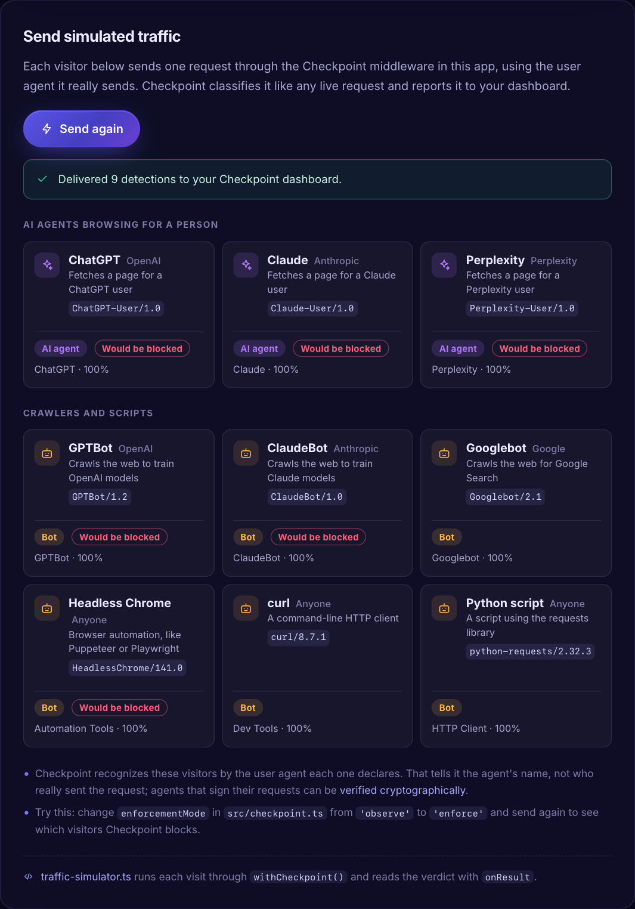

# Detecting AI Agents in Next.js with Vouched KYA

Are you wondering how many AI agents are visiting your website? [`@kya-os/checkpoint-nextjs`](https://www.npmjs.com/package/@kya-os/checkpoint-nextjs) makes it easy to find out!

AI agents like ChatGPT, Claude, Perplexity and Gemini are already browsing websites on behalf of real people. And unless we're looking for them, most of our websites can't tell the difference between a person, a crawler and an AI agent acting for a person.

In this post, we'll add Vouched KYA's Detect to an existing Next.js app in about 5 minutes, for free, and see exactly who (or what!) is visiting our site.

You're welcome to skip the definitions and jump directly to the code below.

## What is Know Your Agent (KYA)?

You've probably heard of KYC (Know Your Customer), the identity checks banks and fintech apps run to make sure we are who we say we are. [Know Your Agent](https://kya.vouched.id) (aka "KYA") is the same idea for the agent era: knowing which AI agents are interacting with our business, and which human authorized them.

[Vouched](https://www.vouched.id) created KYA-OS ("Know Your Agent Operating System", pronounced "chaos" 😅), an open standard for AI agent identity and delegation, and donated it to the [Decentralized Identity Foundation](https://identity.foundation). Vouched KYA is Vouched's product suite built on top of it.

## What is Detect?

[Detect](https://kya.vouched.id/docs/detect) identifies AI agents on our website in real time. It classifies every request as `human`, `ai_agent`, `bot` or `incomplete_data`, names the agent when it recognizes one, and assigns a confidence score from 0 to 100 that measures how strongly the evidence points to automation.

For us Next.js developers, Detect ships in the `@kya-os/checkpoint-nextjs` npm package. It runs Vouched's Rust detection engine (compiled to WebAssembly) right inside our app, in the [Proxy](https://nextjs.org/docs/app/getting-started/proxy) that Next.js runs before every request (you might know it by its old name, Middleware). There's no extra network hop before our page responds, so it adds just a few milliseconds to each request. We'll run it in observe mode, so it never blocks anyone, and here's the best part: Detect is [free](https://kya.vouched.id/pricing). No credit card required!

## What about Enforce and Govern?

Once we know which agents are visiting, we'll naturally want to decide what each one is allowed to do. That's where Vouched KYA's upgrades come in:

- **[Enforce](https://kya.vouched.id/docs/enforce)** applies policies to the agents Detect finds: allow, block, redirect or challenge them. We write the policies in plain language in the Vouched KYA dashboard (they compile to [Cedar](https://kya.vouched.id/docs/enforce/policies)) and deploy them from there, without redeploying our app.
- **[Govern](https://kya.vouched.id/docs/govern)** goes one step further: AI agents present cryptographic proof of who authorized them and what they're allowed to do, so a verified agent can safely check out on a customer's behalf.

Both are free to trial, and production-scale Enforce and Govern come with the [Enterprise plan](https://kya.vouched.id/pricing). We'll dig into each of them in future posts. Today, let's start with Detect!

## Code

Now that we have those pesky definitions out of the way, let's write some code!

You can find the completed code sample here: [https://github.com/TheCodeTraveler/KnowYourAgentWebsite-JavaScript-Nextjs](https://github.com/TheCodeTraveler/KnowYourAgentWebsite-JavaScript-Nextjs)



### Prerequisites

If you'd like to follow along, here are the steps.

- An existing Next.js 16 app, using the App Router or the Pages Router
- [Node.js 22.12](https://nodejs.org/en/download) or later
- A free Vouched account: [kya.vouched.id/signup](https://kya.vouched.id/signup)

Once you're signed in:

1. Create a new project for your website
2. Create an **API key** (it starts with `sk_`) for that project: ask the assistant on the dashboard's **Home** page for your project's credentials, or open your user menu and go to **All settings → API keys**

If you get stuck, Vouched's [Credentials docs](https://kya.vouched.id/docs/credentials) walk through exactly where to find it.

### 1. Add the npm Package

First, let's add the [`@kya-os/checkpoint-nextjs` npm package](https://www.npmjs.com/package/@kya-os/checkpoint-nextjs) to our Next.js app:

```bash
npm install @kya-os/checkpoint-nextjs
```

It brings along Vouched's detection engine, `@kya-os/checkpoint-wasm-runtime`, so there's nothing else to install.

Heads-up: the package and its APIs use the name Checkpoint, so you'll see it throughout the code below.

### 2. Store our API Key (Safely!)

Before we write any code, let's talk about where our API key lives. It's a secret, and it should NEVER be committed to source control.

Good news: Next.js has our back! It automatically loads environment variables from a `.env.local` file in the root of our project, and the `.gitignore` that `create-next-app` generates already ignores every `.env` file. (Double-check yours, just in case. Your future self will thank you! 💯)

In the root of our project, next to `package.json`, create `.env.local`:

```bash
CHECKPOINT_API_KEY=<your api key>
```

Not a fan of copy/pasting keys? Me neither! Vouched's [`kya-os` CLI](https://kya.vouched.id/docs/installation) can do this for us. From the same folder, run `kya-os login`, then `kya-os detect install --surface sdk --project <your project id>`. It offers to create a brand new API key and saves it to `.env.local` for us. (It can wire up `proxy.ts` too, but let's write that ourselves, so we know what every line does.)

When we deploy our app, we'll set the same `CHECKPOINT_API_KEY` environment variable in our host, for example in our Vercel project's **Environment Variables** settings. Next.js reads it the same way, so our code doesn't change between environments.

### 3. Add Vouched KYA to proxy.ts

Now we can finally write some code!

Next.js runs `proxy.ts` before every request reaches our pages, which makes it the perfect place for Detect. Create `proxy.ts` in the root of our project, or in `src/` if our app uses a `src` folder, and let's wrap the SDK's `withCheckpoint()` around it:

```ts
import { withCheckpoint } from "@kya-os/checkpoint-nextjs";

export default withCheckpoint({
  // Reports every request to our Vouched KYA dashboard
  apiKey: process.env.CHECKPOINT_API_KEY,

  // Observe mode: classify and report every request, but never block one
  enforcementMode: "observe",
});

export const config = {
  // Run on every page, but skip Next.js' static files
  matcher: ["/((?!_next/static|_next/image|favicon.ico).*)"],
};
```

That's it! One function call. 🎉

A couple of things worth pointing out:

- **`enforcementMode: "observe"` is observe mode.** `withCheckpoint` enforces by default, so I like being explicit here. That way, the next developer who reads our code knows we're intentionally not blocking anything (yet!).
- **The `matcher` skips Next.js' static files.** Without it, Next.js runs `proxy.ts` for every JavaScript bundle, image and font too, and there's no reason to classify those.

What if we forget to add our API key? Don't worry, our app still works! Without `apiKey`, the SDK still classifies every request, right on our machine. It just doesn't report anything to our dashboard.

### 4. Click Run

Now let's run our app and see what happens 👀

```bash
npm run dev
```

Our website looks exactly the same in the browser. That's the point! Observe mode doesn't change anything for our visitors.

In the terminal, we'll see one warning when the app starts: `[checkpoint] signed requests are claimed in this process only`. It's about AI agents that cryptographically sign their requests, which Vouched KYA accepts only once each. Without our Project ID, it keeps track of them in this one server process, which is all we need for detecting. We'll come back to it in a future post.

To see Detect in action, let's pretend to be an AI agent. Open a second terminal and send a request using ChatGPT's user agent (on Windows PowerShell, type `curl.exe` instead of `curl`):

```bash
curl -I -A "Mozilla/5.0 AppleWebKit/537.36 (KHTML, like Gecko); compatible; ChatGPT-User/1.0; +https://openai.com/bot" http://localhost:3000/
```

Among the response headers, we'll find these:

```text
HTTP/1.1 200 OK
x-checkpoint-engine: checkpoint-engine-wasm
x-checkpoint-engine-version: 0.7.0
x-checkpoint-mode: observe
x-checkpoint-would-have-been: Permit
```

It works! `x-checkpoint-mode: observe` confirms that Detect is running, and `x-checkpoint-would-have-been` tells us what it would have done if it were enforcing. For now, that's `Permit`, because we haven't asked it to block anyone.

Now open the [Vouched KYA dashboard](https://kya.vouched.id/dashboard), make sure the project we created is selected, and go to **Detect → Activity**. Within a minute, our request shows up as an `ai_agent`, labeled ChatGPT. 🎉

Not seeing it? Add `debug: true` to `withCheckpoint` for a moment. The SDK's reports are silent by default, so they can never slow down or break our site, and `debug` logs why a report didn't reach Vouched, like a mistyped API key.

Let's try OpenAI's GPTBot crawler next by swapping in its user agent: `Mozilla/5.0 AppleWebKit/537.36 (KHTML, like Gecko); compatible; GPTBot/1.4; +https://openai.com/gptbot`. This time, the dashboard labels it a `bot` instead of an `ai_agent`. That's an important distinction: GPTBot is a crawler collecting training data, while ChatGPT-User is an AI assistant browsing on behalf of a real person.

### 5. Read the Verdict in Code

The dashboard is great, but the real power comes from using the verdict in our own code. The SDK calls `onResult` after it classifies each request, which is the perfect place to log it, send it to our analytics, or save it to our database.

Let's add `onResult` to `proxy.ts`, right after `enforcementMode`:

```ts
export default withCheckpoint({
  apiKey: process.env.CHECKPOINT_API_KEY,
  enforcementMode: "observe",

  // Runs after Vouched KYA classifies each request
  onResult: (result, request) => {
    const { detectionClass, detectedAgent, confidence } = result.detectionDetail;
    console.log(
      `${request.nextUrl.pathname}: ${detectionClass.type} ${detectedAgent?.name ?? ""} (${Math.round(confidence)}%)`,
    );
  },
});
```

Now let's send the ChatGPT and GPTBot requests again, plus one from plain old curl (`curl -I http://localhost:3000/`), and watch the terminal running our app:

```text
/: AiAgent ChatGPT (100%)
/: Bot GPTBot (100%)
/: Bot Dev Tools (100%)
```

Vouched KYA recognized all three, and even knows that curl is a developer tool! And if our `onResult` code ever throws an exception, the SDK catches it, so a hiccup in our analytics can never take our website down.

One thing to know: the SDK waits for `onResult` to finish before it responds, so keep it quick. For slower work, like saving to a database, wrap it in Next.js' [`after()`](https://nextjs.org/docs/app/api-reference/functions/after), which runs it after the response is sent.

Want a sneak peek at Enforce? Add `engineConfig: { tier3Action: "block" }` under `enforcementMode`, and the engine flags known AI agents, AI crawlers and headless browsers. Because we're still in observe mode, nothing gets blocked, but the ChatGPT request now comes back with:

```text
x-checkpoint-would-have-been: Block
x-checkpoint-would-have-been-reason: Tier3UAMatch
```

Switch `enforcementMode` to `"enforce"`, and the SDK blocks them for real: our ChatGPT `curl` request now gets a `403 Forbidden`. But that's a topic for a future post!

## Bonus: Unit Testing our Proxy

Here's a fun one: because the detection engine runs inside our app, we can unit test our `proxy.ts` by handing it a `NextRequest` with any user agent we like, with no API key and no network required.

The sample repo includes a suite of [Vitest tests](https://github.com/TheCodeTraveler/KnowYourAgentWebsite-JavaScript-Nextjs/tree/main/test) that verify how ChatGPT, GPTBot, ClaudeBot, Googlebot, curl and a real Chrome browser are each classified, and exactly what the SDK reports to the dashboard for each one. I recommend copying this pattern into your own app. That way, whenever Dependabot proposes a `@kya-os/checkpoint-nextjs` update that changes how our traffic is classified, our CI pipeline tells us before our users notice!

One tip if your tests use Next.js' helpers from `next/experimental/testing/server`, like the sample's do: those helpers expect the `AsyncLocalStorage` that Next.js normally sets up before anything else loads. Without it, the SDK's startup warning from step 4 fails our first test with "AsyncLocalStorage accessed in runtime where it is not available". The fix goes in our Vitest setup file, like the sample's [`setup.ts`](https://github.com/TheCodeTraveler/KnowYourAgentWebsite-JavaScript-Nextjs/blob/main/test/support/setup.ts):

```ts
import { AsyncLocalStorage } from "node:async_hooks";

// Next.js sets this up before anything else loads, and its test helpers expect it
(globalThis as { AsyncLocalStorage?: typeof AsyncLocalStorage }).AsyncLocalStorage ??= AsyncLocalStorage;
```

## Conclusion

As web developers, we can no longer assume that every visitor to our website is a person. AI agents are already here, and thanks to `@kya-os/checkpoint-nextjs`, it only takes one function call (and zero dollars) to start seeing them.

And we've only scratched the surface! Vouched KYA can also verify agents that cryptographically sign their requests, apply policies from our dashboard with [Enforce](https://kya.vouched.id/docs/enforce), and let verified agents act on a customer's behalf with [Govern](https://kya.vouched.id/docs/govern).

You can find the completed code sample here: [https://github.com/TheCodeTraveler/KnowYourAgentWebsite-JavaScript-Nextjs](https://github.com/TheCodeTraveler/KnowYourAgentWebsite-JavaScript-Nextjs)

The sample is a small, open-source Next.js app that does everything in this post, plus one fun extra. Paste your Project ID and API key into the page and it saves them to `.env.local` for you. Then click **Send simulated traffic** to run ChatGPT, Claude, Perplexity, GPTBot, Googlebot, curl and more through the SDK, and watch them all arrive in your dashboard! Only have a Project ID handy? That works too: the Vouched KYA pixel reports your own visits to the sample with just the Project ID.

Building with .NET instead? The [same sample for ASP.NET Core](https://github.com/TheCodeTraveler/KnowYourAgentWebsite-Dotnet-Blazor) adds Vouched KYA with just two lines of code.

Next, we'll move from observing to enforcing: blocking and challenging AI agents with Enforce. Make sure to subscribe to the Vouched KYA newsletter at the bottom of the [Vouched KYA home page](https://kya.vouched.id) so you don't miss it!
